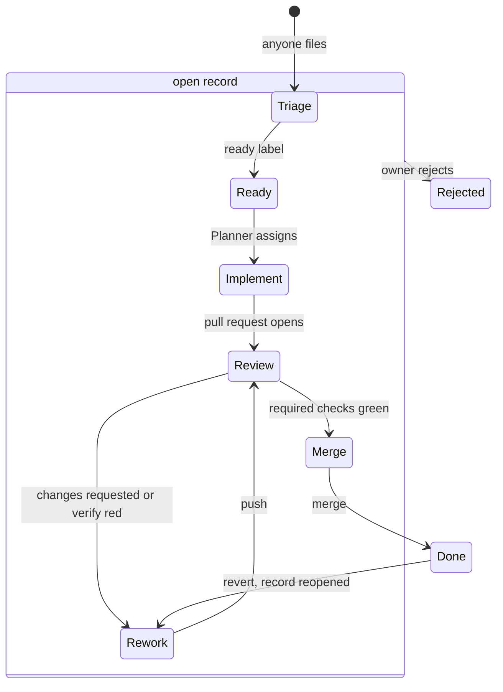

# The lifecycle of a record

A reference for one question: what state is a Conductor record in, what is it waiting for,
and who moves it. It is not a rulebook. The rules live on [the page](../AGENTS.md); where
this file and the page differ, the page governs.

> **Status, 2026-11-21.** The model below was accepted by the owner and is recorded on
> [#124](https://github.com/AhmedAlhanaei/Conductor/issues/124), whose first comment holds
> the thirteen decisions. It is **not yet in force**: ADR 0011 is pending
> ([#125](https://github.com/AhmedAlhanaei/Conductor/issues/125)) and the page still
> describes five statuses (Backlog, Ready, In progress, Review, Done) with File as an owner
> gate. [What is live today](#what-is-live-today) says which parts arrive with which
> record. [Open points](#open-points) lists what is undecided or untested.

A state names the work a record is waiting for, not what happened to it (Ready is the one
name that breaks this). It is read from facts GitHub already holds: labels, assignee, pull
request, checks and reviews of the head, close reason. Nobody writes a status, there is no
board and no workflow that moves states, and the Implementer moves no state.

## A leaf record

A leaf is a record with no sub-issues. "Its pull request" is the open pull request whose
body closes the record.

| State | Waiting for | The GitHub fact |
| --- | --- | --- |
| Triage | the Ready facts and the Ready decision | open, no `status:ready` |
| Ready | the Planner to start a thread | open, `status:ready`, not assigned |
| Implement | a pull request | open, `status:ready`, assigned, no open pull request |
| Review | checks to finish and, where one is required, a review of the head | its pull request is open and neither Rework nor Merge matches |
| Rework | a fix pushed to the branch | its pull request is open and `verify` is red on the head, or the newest review of the head requests changes. Also: reopened after a revert (open, with a merged pull request and no open one) |
| Merge | the merge | its pull request is open and every required check is green on the head |
| Done | nothing | closed as completed |
| Rejected | nothing | closed as not planned, or as duplicate |

The definition is an ordered rule and the first match wins: Done, Rejected, Merge, Rework,
Review, Implement, Ready, Triage. A record is therefore in exactly one state. Searches are
shortcuts for some queues, not the definition: GitHub's `status:` search does not see
Actions checks, so no search lists Merge or the red-check half of Rework.

## A parent record

A parent is any record with at least one sub-issue. Its work happens in its children, so
none of its states is read from a pull request. Until its first sub-issue exists, a record
that will be split reads Triage or Ready as a leaf does. Once it has an open sub-issue the
rule reads it as Implement, whether or not it carries `status:ready`. GitHub reports the
counts on every issue as `sub_issues_summary`. Rejected is reachable from any state.

| State | Waiting for | The GitHub fact |
| --- | --- | --- |
| Triage, Ready | as a leaf; a Ready record with no sub-issues is waiting to be split or started | as a leaf, with no sub-issue yet |
| Implement | its sub-issues | open, at least one sub-issue open |
| Review | a check of the whole outcome against the parent's own criteria | open, every sub-issue closed |
| Done, Rejected | nothing | as a leaf, by close reason |

## Who moves each state

No cell names the Implementer, and the middle column is the only place an assistant moves
a gate. "Owner" includes a session that performs the click on the owner's quoted words
("ready 113"). Conductor's cap is `P2` and its owner-only category is `kind:security`.

| Move | The act on GitHub | `manual` | `auto`: sub-issue within the cap, not owner-only | `auto`: top-level record, above the cap, or owner-only |
| --- | --- | --- | --- | --- |
| into Triage | open an issue | anyone | anyone | anyone |
| Triage to Ready | apply `status:ready`, with a comment naming the approval | owner | Planner | owner |
| Ready to Implement | assign the issue | Planner, after the owner agrees to the thread | Planner, when it starts the thread | Planner, when it starts the thread |
| Implement to Review | the pull request opens | GitHub | GitHub | GitHub |
| Review to Rework | a review requesting changes, or a red `verify` | Reviewer or GitHub | Reviewer or GitHub | Reviewer or GitHub |
| Rework to Review | a push | GitHub | GitHub | GitHub |
| Review to Merge | required checks green on the head | GitHub, after the Reviewer's review where one is required | GitHub, after the Reviewer's review where one is required | the Reviewer's review, then GitHub |
| Merge to Done | the merge | owner | GitHub auto-merge | owner for a top-level record, GitHub auto-merge for a sub-issue |
| promotion into the default branch | the merge | owner | owner | owner |
| Done to Rework | reopen after a revert | owner | owner or Planner | owner or Planner |
| any state to Rejected | close as not planned or duplicate, with the reason | owner | owner | owner |
| parent Implement to Review | the last sub-issue closes | GitHub | GitHub | GitHub |
| parent Review to Implement | file a new sub-issue | Planner files, owner readies | Planner | Planner files, owner readies |
| parent Review to Done | closing report, then close | owner closes | Planner closes | Planner closes |

`grok` mode is the `auto` columns with the Planner's and Reviewer's acts done as
`grok-conductor[bot]`; Grok never implements. The Implementer keeps the work, and posts one
handoff comment only when it stops without a pull request; it applies no label, assigns
nothing and closes nothing. The owner keeps three decisions: Ready, Merge and Reject.

## How a record is created

- **Everything starts in Triage.** Anyone may file an issue with a title, a problem and a
  parent (or "none", with the reason). That is already a record.
- **Before Ready** it gets the rest of the Ready facts: one priority, one `kind:*`, a
  bounded outcome, acceptance criteria (success criteria on a parent), non-goals, allowed
  paths and stop conditions. Whoever applies `status:ready` confirms each has an answer;
  GitHub does not check the fields.
- **Sub-issues.** Work related to an open record is filed as its sub-issue with the native
  parent link, never as a sibling. Three levels and no more: a top-level record, its
  sub-issues, and a `kind:tracking` parent that only holds sub-issues.
- **The Backlog issue** is an optional notebook for one-line ideas, not a state or a
  queue: an idea is in the lifecycle only once it is an issue of its own.

## Rejected, and how a parent closes

Rejected is distinct from Done. It is the owner's decision, reachable from any state, and
shows as an issue closed as not planned (with the reason in one sentence: obsolete, not
feasible or superseded) or as duplicate. A session closes a record this way only on the
owner's quoted words. A parent with at least one finished child closes as Done, and its
unfinished children are Rejected.

1. The last sub-issue closes and the parent reads Review, with no write by anyone.
2. The parent is checked against its own success criteria: by a Reviewer on another
   runtime when it carries `review:required`, by the Planner otherwise.
3. A finding becomes a new sub-issue, and the parent reads Implement again.
4. Otherwise the Planner posts the closing report as the closing comment: every child with
   its pull request and merge SHA, one row per success criterion with its evidence, and
   every Rejected child with its reason. The Planner closes in `auto`, the owner in `manual`.

## With and without a required review

A review is **required** when the record is `P0` or `P1`, is in an owner-only category, or
carries `review:required`. The check computes this from the record, so removing the label
does not switch the gate off for those classes; the label only adds the requirement to
other records.

| | Review required | Not required (`P2`, `P3` without the label) |
| --- | --- | --- |
| Pull request opens | reads Review; `linked-task` stays red | reads Review while checks run |
| What turns it to Merge | a native GitHub review of the head that does not request changes, plus green checks. A new push needs a new review | green checks alone |
| Who reads it before merge | a Reviewer on a runtime other than the Implementer's | nobody. In `auto` a sub-issue merges by itself within minutes. Review on everything was offered to the owner and not taken |
| After merge | Done | Done, with the condition "review pending" until someone reviews the merged pull request; the weekly backlog review lists these |
| Findings after merge | a new sub-issue, or a revert and Rework | the same |

## Flags and conditions

Flags are existing labels beside a state, never in place of it. The Implementer sets none.

| Flag | Meaning | Set by |
| --- | --- | --- |
| `P0` to `P3` | queue order; with the cap, who may ready and whether a review is required | owner; the Planner proposes |
| `kind:*` | the type of work, one per record; `kind:security` wins a tie; `kind:tracking` marks a parent that only holds sub-issues | whoever files; corrected at Ready |
| `agent:*` | which assistant may implement; read once, when work starts; none means any | owner or Planner |
| `review:required` | adds the review requirement to a record that would not have it | Planner at filing; owner anywhere |
| `blocked:owner` | Blocked: waiting on the owner, with a comment saying for what. It sits beside the priority, on a leaf or a parent, in any open state | owner or Planner |

Conditions are read from GitHub; nobody sets or clears them.

| Condition | The fact | Who acts |
| --- | --- | --- |
| Owner-only | priority above the cap, or an owner-only category | the owner readies |
| Review pending | merged pull request with no native review, on a record that did not require one | a Reviewer on another runtime |
| Waiting for a reviewer | open pull request with no review of the head for longer than a set number of days | the Planner asks a Reviewer |
| Reverted | open record with a merged pull request and no open one, once someone reopens it | owner, or Planner in `auto`, reopens; GitHub does not |
| Has Rejected children | sub-issues closed as not planned | the Planner names them in the closing report |

## What is live today

At `main` ca08a55. Each line changes when its record merges; this section is then stale.

| Part of the model | Today | Arrives with |
| --- | --- | --- |
| The eight states and who moves them, on the page | the page has five statuses | #125 |
| File open to anyone; Reject as the owner's decision | File is an owner gate | #125 |
| `status:ready` as the Ready gate | live: `linked-task` requires it | already live |
| A review recorded as a native GitHub review; requirement computed | a `Reviewer: ..., reviewed SHA: ...` line in the pull request body; the label alone decides | #126 |
| The Implementer posts no claim or milestone; the assignee marks Implement | claim, milestone and release comments | #127 |
| Filing with title, problem and parent only | the form requires every Ready fact | #128 |
| Blocked beside a priority | `blocked:owner` replaces the priority | #128 |
| Rejected children in the closing report; weekly list of unreviewed merges | neither | #128 |

## Open points

1. **Same-account reviews.** Every Claude session acts as the owner's login. As #126 is
   written, a review by the author's login counts when its text starts with the word
   `Reviewer:` and a runtime, so the check cannot tell a Claude Reviewer from the Claude
   Implementer. The strict alternative counts only a login other than the author's, which
   stops Claude reviewing any pull request opened under the owner's account.
2. **A parent with a pull request of its own.** Parent states are not read from a pull
   request, yet today's page gives a record with sub-issues a `Refs #n` pull request.
3. **The wording of the review requirement.** "P0, P1" and "above the cap" agree only
   where the cap is `P2`; whether `manual` is covered is not stated.
4. **Who applies `status:ready` to a top-level record** on the owner's words. A session
   has since 2026-11-20; the page does not say so consistently.

The four above are the owner's to decide. Not tested, so `unknown`: whether a native review
can be submitted on a merged pull request ("review pending" cannot clear without it);
whether `grok-conductor[bot]` can submit a review or be a requested reviewer; which of two
`linked-task` results on one head the required check honours; whether the `review:none`
search drops a pull request after a comment-only review.
